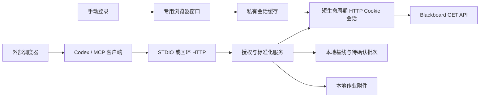

# MCP 架构与数据语义

当前实现采用 Python + Playwright 登录 + HTTPX 读取/流式下载 + FastMCP。登录、读取、监控状态和外部调度各自独立，没有内部定时器、通知发送器或数据库服务。

## 认证与传输

登录使用专用 Chromium Profile；MCP 每次工具调用从保存的 Cookie 创建独立 HTTPX AsyncClient，不启动浏览器、不读取交互式输入。API、页面和文件请求共享 Cookie jar；本人注册接口确认身份后保存更新，401/明确登录页面清除失效缓存。完整 origin 包含端口，TLS 校验保持开启。文件下载允许经过逐跳校验的同源、同附件 WebDAV 重定向。

同一实例的工具串行执行；共享 `.session.lock` 防止多个进程或登录程序同时修改会话。冲突返回 `session_busy`，不删除其他浏览器锁。

默认 STDIO 的 stdout 只承载 MCP 协议。HTTP 只绑定 `127.0.0.1`，要求独立的 MCP Bearer token；该 token 不等于学校 Cookie，也不是 OAuth 实现。HTTP 默认不打印访问日志。未提供公共服务器或代理配置。

## 数据与完整性

统一结果含 `source`、`fetched_at`、`cached`、`complete`、`state`、`warnings`、`data`。业务错误也返回此结构，调用方必须检查它；不能仅根据 MCP 调用没有抛出协议错误判断成功。

| 数据 | 规则 |
| --- | --- |
| 课程 | 完整注册分页，按内部 ID 授权；详情按 ID 缓存在单次调用内；同名课程不合并 |
| 学期 | 用 API 的明确 `termId`。默认跨课程操作须配置 `current_term_id`；不按注册时间猜测 |
| 内容树 | DFS，重复 ID/深度/节点限制标为不完整；分页不全不当空列表 |
| 作业 | `resource/x-bb-assignment` 内容才算作业；按 `Content.id = Column.contentId` 关联所有列 |
| 评分列 | `score.possible` 为满分；个人分数为 null，提交状态 unknown。缺失列使查询不完整 |
| 截止时间 | API 日期必须有时区；存 UTC，展示配置时区；保留系统及正文候选值和推断依据 |
| 正文解析 | 支持明确年月日/英文月份/中文月日和时间；缺年仅在系统同月日时借年，并标注；不确定表达要求核实 |
| 时间冲突 | 同时保留两种来源；较早的可靠时间仅供提醒，不改写系统截止时间 |
| 课件 | document、file、externallink；只对支持的类型查询附件。附件失败返回明确状态 |
| 作业附件 | 验证注册与作业 ID，从父目录页面的精确条目发现链接；只下载匹配该作业与资源 ID 的同源 WebDAV 文件 |
| 未知类型 | 保留内容树原类型；监控遇到不支持的类型返回不完整，避免静默漏报 |
| 文本 | HTML 转纯文本，移除脚本等节点；内容仍为不可信来源数据，不具备 Agent 指令权限 |

网络请求有路径白名单、同源和同端口验证、禁止自动重定向、分页循环检测、请求次数和时间上限。403/401 不重试；JSON API 对 429/5xx/网络故障有限退避；页面和附件失败直接报告。每个附件至多 5 次请求，逐跳检查重定向。预算见 `config.example.toml`，是本项目的保守设置，不是学校公布的限额。

`complete=true` 表示本次声明范围内的操作完成。普通查询/监控没有读取文件字节；附件下载则逐文件返回实际大小、SHA-256 与本地路径。下载批次部分失败时保留已完成文件，返回 `partial` 与失败列表，不报告全部成功。正文日期有歧义时可保持完整的元数据扫描，同时返回 warning 和 `needs_review`。

附件使用有大小上限的流式传输与临时文件；中断或取消清理临时文件。文件名采用 `课程名-原附件名`，过滤 Windows 路径/设备名并限制长度，目录按账户、课程、作业隔离，拒绝目录链接与跳出目标目录的路径。重复目标需校验哈希才复用；同名不同内容使用数字后缀，发布时不覆盖已有文件。SHA-256 和附件 ID 保留在返回值中，不进入文件名。不自动解压、运行或解析附件正文。下载到远端 MCP 时，本地路径不会自动映射到客户端。

## 监控持久化

账户键为 origin 与 API `userId` 的 SHA-256；每个账户/`watcher_id` 有独立文件，范围必须保持一致。监控目录位于受保护 Profile 内，继承私有权限；保存最小元数据、描述哈希和日期证据，不保存正文全文或凭证。Windows 的 Cookie 文件使用 DPAPI，监控快照仅受文件权限保护，不声称加密。

首次完整扫描建立基线。之后变化保存为 pending，得到稳定事件 ID 和批次 token。重复检查先验证账户身份，再重放该批次，不覆盖它。只有显式确认才提交新的基线；确认重试幂等。无变化的完整扫描可更新观测时间。

这提供至少一次交付语义，无法单凭 MCP 返回保证通知已送达。调用方保留交付证据后确认，具体见[监控协议](monitoring.md)。扫描间出现又消失的变化、相同元数据下文件字节被替换，当前无法发现。

## 接入边界

本项目提供本地 MCP 服务与插件包；远程 ChatGPT、实际调度与通知渠道需要在目标客户端配置和验证。HTTP Host/Origin 校验、协议错误标记及部分工具注解仍有待完善，见 [已知限制](limitations.md)。多用户托管、OAuth、远程文件传输、个人 Grade/Attempt 不属于本版。附件范围见 [附件下载说明](attachments.md)。
